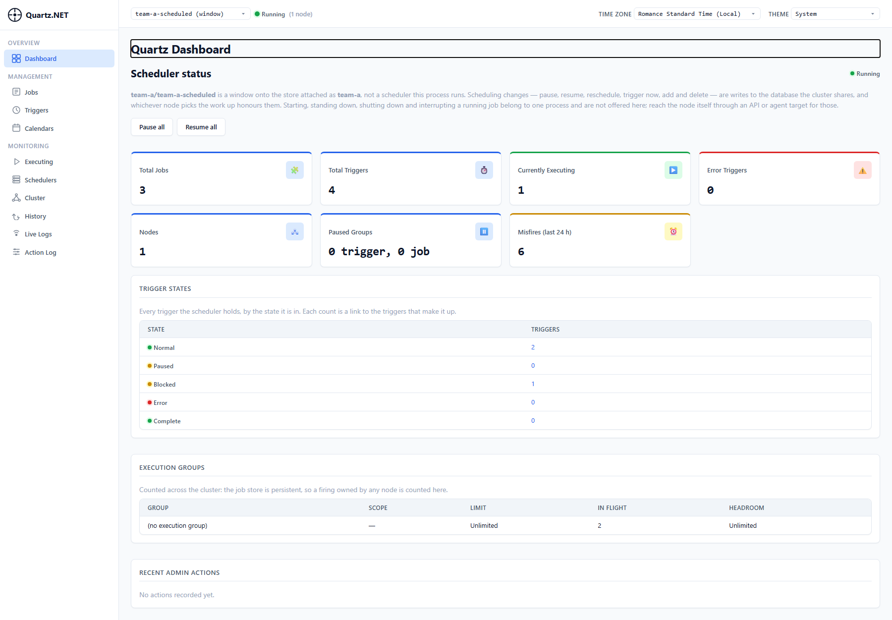
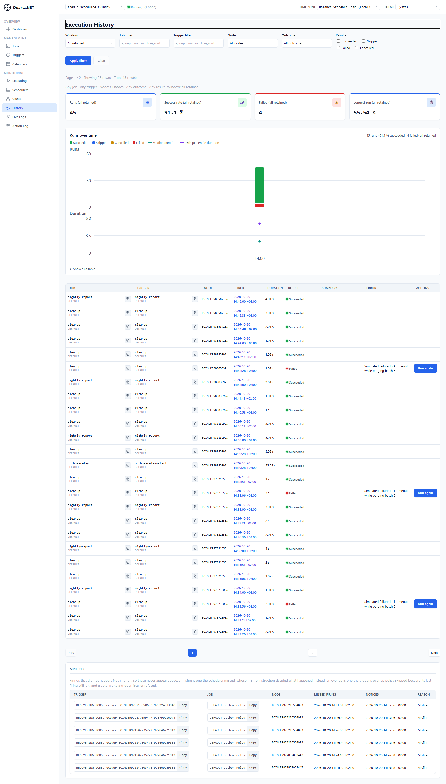
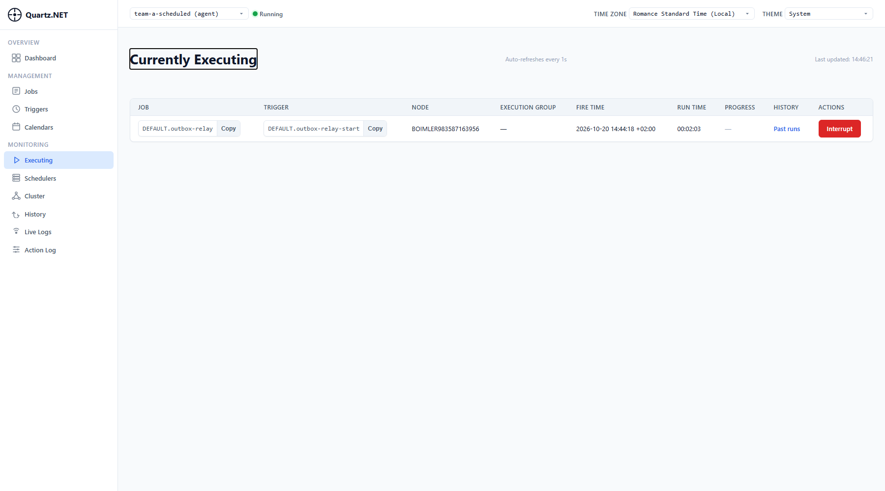

# QuartzNetAspire — one Quartz.NET 4 dashboard for jobs that are deployed separately

An [Aspire](https://aspire.dev) 13.6 / .NET 10 sample that answers one question: *can teams that deploy their
scheduled and continuous workers independently still be monitored from a single [Quartz.NET 4 dashboard](https://www.quartz-scheduler.net/documentation/quartz-4.x/packages/dashboard.html)?*

Yes. The sample runs two "teams" that never share a deployment, plus the one dashboard that sees both:

| Resource | Team | Store | How the dashboard sees it |
|---|---|---|---|
| `scheduled-worker` | A | SQL Server, clustered persistent store (`Quartz.Aspire`) | **Store-attached** window (dashboard reads the database) **and** a **Dashboard Agent** (worker dials the dashboard) |
| `queue-worker` | B | In-memory | **Dashboard Agent** only (no database at all) |
| `quartz-dashboard` | — | none | Hosts `Quartz.Dashboard` + the Quartz HTTP API |
| `sql`, `rabbitmq` | — | containers | SQL Server 2022 (database `quartz-scheduled`), RabbitMQ with management UI |

Jobs:

- **Scheduled** (Team A): `nightly-report` (cron, every 2 min in the demo) and `cleanup` (every 45 s, fails every 5th run on purpose).
- **Continuous** (Team A): `outbox-relay`, a long-running job that simulates a transactional-outbox relay and publishes an `OrderPlaced` message to RabbitMQ (EasyNetQ) at random 1–10 s intervals.
- **Continuous** (Team B): `order-listener`, a long-running job that holds an EasyNetQ subscription and "processes" every `OrderPlaced`.

Quartz's own OpenTelemetry spans and metrics (`Quartz.Job.Execute`, `Quartz.JobStore.*`, `quartz.job.execution.duration`, …) flow into the Aspire dashboard, and every relayed order is one trace that spans both workers.

## Prerequisites

- .NET 10 SDK (a `global.json` pins 10.x; an installed .NET 11 preview is ignored)
- Aspire CLI 13.6 (`aspire --version`)
- A container runtime: Podman or Docker (Aspire auto-detects Podman)

## Run

```powershell
cd src/QuartzNetAspire
aspire run
```

or `dotnet run --project QuartzNetAspire.AppHost --launch-profile http`. The first start pulls the SQL Server and RabbitMQ images (a few minutes). Both containers use `ContainerLifetime.Persistent`, so later starts are fast and the Quartz tables survive restarts.

That persistence has one catch: Quartz's `SchemaProvisioning.CreateIfMissing` only creates missing tables, it never alters one. When a Quartz release adds a column (4.7 added the mandatory `QRTZ_TRIGGERS.FIXED_DELAY`), the worker refuses to start against the old schema and names the script. Either run `database/migrations/<version>/*_sqlServer.sql` from the [quartznet repo](https://github.com/quartznet/quartznet/tree/main/database/migrations) against `quartz-scheduled`, or, for this demo, `podman rm <sql-container>` and let the next start provision a fresh schema (history rows are lost).

Open the Aspire dashboard URL printed to the console. Wait until all five resources are **Running**; `quartz-dashboard` has an external endpoint.

## Demo walkthrough

### 1. The central Quartz dashboard

Open the `quartz-dashboard` endpoint (it redirects to `/quartz`). The scheduler picker at the top lists three entries:

| Picker entry | What it is |
|---|---|
| `team-a-scheduled (window)` | The dashboard reading Team A's SQL Server store directly. Cluster-wide: every node, every firing, the full execution history from the database. |
| `team-a-scheduled (agent)` | The same scheduler, reached through the agent running inside the worker process. Node-local: this is where **Interrupt** and **Live Logs** work. |
| `team-b-queue (agent)` | Team B's in-memory scheduler, visible only because the worker dialed in. No database involved. |

Select the **window** and read the banner on the Dashboard page: scheduling changes (pause, trigger now, delete) are writes to the shared database, but "starting, standing down, shutting down and interrupting a running job belong to one process" — that is why Team A also runs the agent.



### 2. Scheduled jobs and history

Still on the window: **Jobs** shows `cleanup`, `nightly-report`, `outbox-relay` with last run / last success. **History** shows every run with duration, result and the error text of the failed `cleanup` runs (every 5th run throws). The history comes from the `QRTZ_EXECUTION_HISTORY` table, so it is complete across restarts and nodes. **Cluster** lists the worker node with its check-ins.



### 3. Continuous jobs

**Executing** shows `outbox-relay` (Team A) and, after switching the picker to `team-b-queue (agent)`, `order-listener` (Team B), both with a run time that keeps growing. These are ordinary Quartz jobs whose `Execute` only returns when the job's `CancellationToken` fires.



### 4. Stop and restart a continuous job from the dashboard

1. Pick `team-b-queue (agent)` → **Executing** → **Interrupt** on `order-listener`. The row disappears; the worker logs `Order listener stopped after N messages`.
2. Open the RabbitMQ management UI (the `rabbitmq` resource's `http` endpoint, user `admin` / password `admin`): the queue `…OrderPlaced…_queue-worker` now has 0 consumers and its message count grows while the relay keeps publishing.
3. **Jobs** → **Trigger now** on `order-listener`. It reappears under **Executing** with a generated trigger, the queue drains.
4. Repeat with `team-a-scheduled (agent)` and `outbox-relay`: Interrupt stops publishing (`Outbox relay stopped after order N`), Trigger now resumes with the next order id.

Try the same Interrupt on `team-a-scheduled (window)`: the button is not offered, because the window is not the process that runs the job.

### 5. The same data as JSON

The dashboard host also maps Quartz's HTTP API under `/quartz-api` (what the dashboard's HTTP-target mode would consume):

```powershell
$d = "http://localhost:5310"   # the quartz-dashboard endpoint
curl "$d/quartz-api/schedulers"                                   # window + both agents
curl "$d/quartz-api/schedulers/team-a-scheduled/jobs"
curl "$d/quartz-api/schedulers/team-a-scheduled/triggers"
curl "$d/quartz-api/schedulers/team-a-scheduled/jobs/fire-instances"   # currently executing
curl "$d/quartz-api/schedulers/team-a-scheduled/nodes"                 # cluster check-ins
curl "$d/quartz-api/schedulers/team-a-scheduled/triggers/DEFAULT/nightly-report/fire-times"   # next 10 fire times (new in 4.7)
```

The bare scheduler name resolves to the window. Agent targets are not addressable through the HTTP API, still true in 4.7.1 (`team-b-queue` returns 404 and names the target that holds it).

### 6. OpenTelemetry in the Aspire dashboard

- **Traces**: filter by `scheduled-worker`. Every scheduled run is a `Quartz.Job.Execute` root span; store calls are `Quartz.JobStore.*` client spans. Every relayed order is its own trace: `outbox.relay` → RabbitMQ `publish` (scheduled-worker) → `deliver` (queue-worker), linked through the message headers by RabbitMQ.Client 7.
- **Metrics**: meter `Quartz` with `quartz.job.execution.duration` (by `quartz.job.result`), `quartz.trigger.acquired`, `quartz.cluster.checkin.duration`, `quartz.jobstore.operation.duration`, `quartz.jobstore.lock.wait.duration`, all tagged with `quartz.scheduler.name`.
- **Structured logs**: job log lines carry the `quartz.job.name` / `quartz.trigger.name` scope (`AddJobLogScope`).

From the terminal: `aspire otel traces scheduled-worker`, `aspire otel spans queue-worker`, `aspire otel logs quartz-dashboard`.

### 7. A worker goes away

Stop `queue-worker` in the Aspire dashboard. On the Quartz **Schedulers** page its agent row turns to *Unknown* as soon as the connection drops (a hung worker takes three missed heartbeats, 45 s). Start it again: it re-registers and `order-listener` is running again because the `StartNow` trigger is re-added on every startup.

## What Quartz scheduling means in Kubernetes (Quartz vs CronJob)

Quartz is an **in-process** scheduler. It never starts a container; the schedule and the job code live in the same long-running process (or in a cluster of identical processes sharing one job store). On Kubernetes that means **each team's worker is an always-on Deployment**, even if it has a single job at 02:00. The pod idles most of the day waiting for the trigger. For a .NET worker that is a few tens of MB of memory and near-zero CPU, but it is a pod per team that never exits.

The native Kubernetes alternative for "start a container at 02:00 and exit" is a **CronJob**. The two are not interchangeable; they trade visibility against idle resources:

| | Quartz inside an always-on worker (this sample) | Kubernetes CronJob |
|---|---|---|
| Process model | Deployment, running 24/7, fires jobs in-process | Pod created at the scheduled time, exits when done |
| Idle cost | one pod per team, idle between firings | none |
| Where the schedule lives | code / job store; change it from the dashboard without a redeploy | the CronJob manifest; change = `kubectl apply` |
| Central view across teams | **one Quartz dashboard**: jobs, triggers, currently executing, history, failures, misfires, cluster nodes | Kubernetes tooling (kube-state-metrics, Lens, Argo, …); per-namespace, no job-level history beyond pod logs |
| Operate a running job | Interrupt, Trigger now, pause/resume, "run again" from the dashboard | delete the pod; re-run by creating a Job from the CronJob |
| Missed firings (rollout, node down) | misfire instructions: fire now, skip, catch up; recorded as misfires | `startingDeadlineSeconds` + `concurrencyPolicy`; a missed window is a Kubernetes event |
| Scale-out / exactly-once | clustered store: one node fires each trigger; replicas for HA | one pod per firing; `concurrencyPolicy: Forbid` to avoid overlap |
| Continuous jobs (queue listener, outbox relay) | first-class: a long-running job, visible and interruptible on the same dashboard | not a fit; needs a Deployment anyway |
| Sub-minute or complex schedules | cron with seconds, intervals, calendars, RFC 5545 recurrence, time zones | minute granularity, cron syntax only |
| Dependencies | job chaining, continuations, execution groups | none built in |
| Team independence | each team ships its own image; the dashboard needs nothing from them except the agent package and a token | each team ships its own CronJob manifest |

Rules of thumb:

- A worker that already runs all day (queue listeners, relays, anything with several jobs) belongs on Quartz. The idle pod exists anyway, and the dashboard comes for free.
- A team with a single run-to-completion job that fits in a container can use a CronJob and accept that it is monitored through Kubernetes, not through the Quartz dashboard.
- If the single-dashboard requirement must hold for everything, the middle ground is a **launcher**: one always-on Quartz worker whose jobs create Kubernetes Jobs from the teams' images through the Kubernetes API (`KubernetesClient` NuGet), wait for them, and record the result. One idle pod in total, every team on the dashboard, teams keep shipping their own images. The price is a shared component with RBAC to create Jobs that someone has to own. This sample does not implement it.

## Layout

```
QuartzNetAspire.AppHost          SQL Server + RabbitMQ containers, three projects, shared agent token
QuartzNetAspire.ServiceDefaults  Aspire template + AddSource("RabbitMQ.Client.*")
QuartzNetAspire.Contracts        OrderPlaced record, AMQP-URI → EasyNetQ connection helper
QuartzNetAspire.ScheduledWorker  Team A: Quartz.Aspire persistent store, 2 scheduled jobs, outbox relay, dashboard agent
QuartzNetAspire.QueueWorker      Team B: in-memory store, dashboard agent, order listener
QuartzNetAspire.Dashboard        Quartz.Dashboard (AttachStore + AcceptAgents) and the HTTP API, anonymous (demo only)
```

See [HowItWasBuilt.md](HowItWasBuilt.md) for the design discussion, the alternatives that were rejected and the pitfalls hit on the way.
